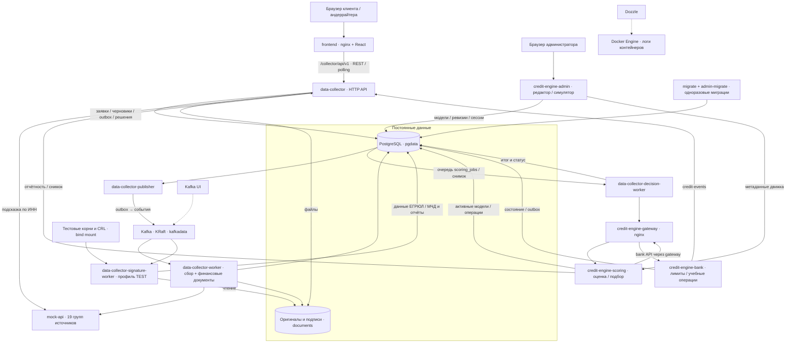

# Умный кредитный кабинет предпринимателя

Проект для Альфа-Хак 2026: кабинет ИП/ООО и рабочее место сотрудника банка. Клиент выбирает продукт, заполняет анкету, прикладывает документы, получает решение и предложения, отвечает на вопросы банка и проходит демонстрационное подписание договора. Сотрудник банка видит очередь, собранные данные, результат скоринга и принимает решение по заявкам на ручном рассмотрении.

Все необходимые компоненты запускаются локально в Docker Compose. Внешние источники заменены собственным `mock-api`, данные компаний и пользователей синтетические. Для демонстрации не нужны доступы к ФНС, БКИ, банковским API или платным ML/LLM-сервисам. Интернет нужен при первой загрузке образов и зависимостей.

## Документация

| Материал | Ссылка |
|---|---|
| Архитектурная схема всего решения | [Схема и взаимодействие компонентов](#архитектурная-схема) |
| Диаграмма состояний заявки | [FSM: диаграмма, переходы и клиентские этапы](docs/fsm.md) |
| Модель данных | [Таблицы и поля](docs/db-schema.md), [ER-модель DBML](docs/db-schema.dbml), [миграции](db/migrations/) |
| Описание текущего API | [API backend: маршруты, авторизация, тела и ошибки](docs/api.md) |
| OpenAPI / Swagger | [OpenAPI 3.0.3](api/openapi.yaml), [Swagger 2 JSON](data-collector/docs/swagger.json), [Swagger 2 YAML](data-collector/docs/swagger.yaml) |
| Запросы к API | [HTTP-коллекция](api/requests.http), [JSON-примеры A–E](data-collector/examples/) |
| Тестовые сценарии | [Полный сценарий запуска и демонстрации](docs/run-scenarios.md), [автоматические проверки](#автоматические-проверки) |
| Синтетические данные и учётные записи | [Входные данные backend](docs/backend-test-data.md), [пользователи](#тестовые-пользователи-и-данные) |
| Сторонние компоненты и смоделированные интеграции | [THIRD_PARTY_NOTICES](THIRD_PARTY_NOTICES) |
| Сбор данных и источники | [Сбор](docs/data-collection.md), [каталог mock-api](docs/mock-api-guide.md) |
| Документы и подписи | [Финансовые документы](docs/financial-documents.md), [проверка ЭП](docs/e-signature.md) |
| Скоринг и обработка очереди | [Очередь, снимки, повторы и масштабирование](docs/scoring-dispatch.md), [credit-engine](credit-engine/README.md) |

## Возможности и границы MVP

- Кабинет: тестовый вход, компании, продукты, калькулятор, серверный черновик и отправка анкеты.
- Сбор: outbox в PostgreSQL, Kafka, опрос 19 групп внешних источников, сохранение ответов и причин пропуска/ошибок.
- Документы: оригиналы, откреплённые подписи, отчёты проверки, разбор поддерживаемых финансовых форм, поколения обработки и диагностика.
- Решение: детерминированные скоринговые модели `ip-v2` / `legal-v2`, предложения, отказ, запрос сведений или ручное рассмотрение.
- Банк: очередь и досье, назначение исполнителя, запрос информации, одобрение или отказ.
- Договор: выбор предложения, скачивание демонстрационного текста `.txt`, подтверждение кодом и учебная выдача (`OFFERED → SIGNING → COMPLETED`).
- Конструктор скоринга: редактор моделей, проверки, симуляции, история и применение сохранённой модели через PostgreSQL. Активная модель читается работающим скорингом; экспорт и генерация комплекта остаются отдельным путём выпуска.

Мок-вход не является промышленной авторизацией. Подписание кодом и выдача учебные: SMS и реальные переводы не выполняются. Проверка документов работает в профиле **TEST** с тестовыми сертификатами и CRL, а не как проверка УКЭП. КЭП кредитного договора и WebSocket присутствуют только в старых браузерных демо-экранах. Живой кабинет обновляется опросом backend. OCR сканов не поддерживается: финансовый парсер использует текстовый слой PDF и таблицы.

## Требования к окружению

Для контейнерного запуска:

- Docker Engine с плагином Docker Compose v2 либо Docker Desktop с Compose v2.
- GNU Make и Git. В Windows команды выполнять из WSL2 с доступом к Docker.
- Современный браузер. Для браузерных моков MSW нужен `localhost` или HTTPS.
- Свободные порты из следующего раздела; занятые порты можно изменить в `.env`.

Ориентир для комфортной локальной демонстрации: 4 CPU, 8–16 ГБ RAM и 10–15 ГБ свободного диска для сборок, образов и данных. Это рекомендация, а не измеренный минимальный профиль. Первая сборка тяжелее последующих. Go, Node и Python на хосте для `make up` не требуются.

Для разработки и проверок без контейнеров нужны Go **1.26.8** (`go.mod` каждого модуля), Node **24.22.x** (`frontend/.nvmrc`), npm и Python 3.12 для финансового парсера. `curl` и `jq` нужны для shell-примеров API. Зависимости устанавливать через `npm ci`, `go mod download` и [requirements.txt](data-collector/financial_parser/requirements.txt).

## Быстрый запуск с настоящим backend

Все команды этого раздела выполнять из корня репозитория.

1. Подготовить конфигурацию:

   ```bash
   make env
   ```

   Создаётся `.env` из `.env.example`, только если файла ещё нет. Существующая конфигурация сохраняется.

2. Для основной демонстрации установить в `.env`:

   ```dotenv
   FRONTEND_API_MOCK=false
   FRONTEND_COLLECTOR_MOCK=false
   SEED_TEST_USERS=true
   SEED_TEST_APPLICATIONS=true
   ```

   В исходном `.env.example` оба флага моков включены. Без изменения интерфейс показывает данные MSW, даже если backend запущен. В выбранном выше режиме новые заявки, документы, скоринг и рабочее место банка обслуживает backend; старые браузерные демо-экраны отключены.

3. Собрать и запустить весь стек:

   ```bash
   make up
   make ps
   ```

   Compose поднимает PostgreSQL, Kafka, эмулятор, API, обработчики, скоринг, админку и frontend. `migrate` и `credit-engine-admin-migrate` должны завершиться с кодом `0`; остальные компоненты должны оставаться запущенными. Первый запуск требует времени на сборку, готовность Kafka и начальные данные.

4. Открыть [кабинет](http://localhost:3000/login). Выбрать тестового пользователя и нажать «Войти как …».

5. Проверить процессы:

   ```bash
   curl --fail http://localhost:3000/healthz
   curl --fail http://localhost:8081/healthz
   curl --fail http://localhost:8082/healthz
   ```

   `/healthz` подтверждает доступность процесса. Для проверки всего конвейера выполнить [сквозной сценарий](#сквозная-проверка).

После изменения `FRONTEND_API_MOCK` или `FRONTEND_COLLECTOR_MOCK` пересобрать frontend: `docker compose up -d --build frontend`. Эти флаги вшиваются в JavaScript; простой `restart` их не применяет. При переходе с MSW на живой backend удалить старый Service Worker в DevTools → Application → Service Workers → Unregister и обновить страницу.

### Адреса

| Компонент | Адрес по умолчанию | Назначение |
|---|---|---|
| Кабинет | [localhost:3000](http://localhost:3000) | клиент и рабочее место банка `/backoffice` |
| Backend API | [localhost:8081/api/v1](http://localhost:8081/api/v1) | REST data-collector |
| Swagger UI | [localhost:8081/swagger/index.html](http://localhost:8081/swagger/index.html) | текущие маршруты backend, Try it out |
| Скоринг через gateway | [localhost:8082/healthz](http://localhost:8082/healthz) | `/api/v1/decisions`, `/api/v1/models`; банковские операции с хоста закрыты |
| Конструктор скоринга | [localhost:8084](http://localhost:8084) | `admin` / `credit-admin`, порт привязан к `127.0.0.1` |
| Mock API | [localhost:8090/healthz](http://localhost:8090/healthz) | локальные эмуляторы источников |
| Kafka UI | [localhost:8086](http://localhost:8086) | топики и consumer groups |
| Dozzle | [localhost:8888](http://localhost:8888) | логи контейнеров |
| PostgreSQL | `localhost:5432` | БД `credit_cabinet`, локальные доступы — в `.env` |
| Kafka | `localhost:9094` | адрес с хоста; в Compose — `kafka:9092` |

Порт `8080` и отдельный сервис `api` в действующем стеке отсутствуют. Клиентский прокси — `http://localhost:3000/collector/api/v1`; он передаёт разрешённые маршруты в data-collector и не раскрывает служебные ручки.

## Архитектурная схема



### Как проходит заявка

1. API регистрирует компанию и черновик. Клиент сохраняет поля анкеты в PostgreSQL, затем отправляет её с документами.
2. Одной транзакцией создаются задача сбора, записи документов и outbox-события. Publisher переносит события в Kafka.
3. Worker собирает ответы `mock-api`, сохраняет `raw_collections` и обрабатывает поддерживаемые финансовые документы. Отдельный worker проверяет подписи и полномочия на данных ЕГРЮЛ/МЧД.
4. Decision-worker ждёт завершения необходимых этапов, фиксирует входной снимок и отправляет его в credit-engine. Очередь, попытки и leases находятся в PostgreSQL.
5. Скоринг применяет активную модель, проверяет условия через банковский компонент и возвращает результат. Кабинет сохраняет решение, предложения или вопросы; результат становится доступен клиенту и сотруднику банка.
6. Клиент принимает предложение. Директор или ИП подтверждает демонстрационный код; backend сохраняет подписание и учебную выдачу.

БД также содержит схемы `credit_engine_admin` и `credit_engine_runtime`: модели, административные сессии, состояние банка, операции и события сохраняются между перезапусками. Документы лежат в общем локальном volume. Для размещения реплик на разных узлах потребуется общее файловое/объектное хранилище. Подробности очереди и масштабирования — в [scoring-dispatch.md](docs/scoring-dispatch.md).

### Компоненты

| Сервисы Compose | Реализация / ответственность |
|---|---|
| `frontend` | React, TypeScript, Vite, Alfa UI, TanStack Query; nginx раздаёт сборку и проксирует REST |
| `data-collector` | Go/Gin, pgx/Jet; кабинет, анкета, каталог, документы, результаты и back-office |
| `data-collector-publisher` | доставка outbox-событий в Kafka |
| `data-collector-worker` | сбор источников, таблицы/PDF через Python, сохранение диагностики |
| `data-collector-signature-worker` | CMS/CAdES, поддерживаемые встроенные подписи PDF, доверие TEST, полномочия |
| `data-collector-decision-worker` | очередь оценок, снимки, leases, повторы, запись итогов |
| `credit-engine-scoring` | модели ИП/ЮЛ, показатели, правила, оценка и подбор условий |
| `credit-engine-bank` | постоянное учебное состояние банка, операции и исходящие события |
| `credit-engine-gateway` | маршрутизация и DNS для реплик scoring/bank; отдельная поверхность API с хоста |
| `credit-engine-admin` | редактор моделей, активные версии, симуляции, история и релизы |
| `postgres`, `migrate`, `credit-engine-admin-migrate` | PostgreSQL 16 и миграции Goose |
| `kafka`, `kafka-ui` | Kafka 4.1.2 в режиме KRaft, один узел; UI для диагностики |
| `mock-api` | Go-сервис с синтетическими seed-ответами внешних систем |
| `dozzle` | просмотр логов через Docker socket |

## Конфигурация

Шаблон — [.env.example](.env.example). `make env` не дописывает новые ключи в уже существующий `.env`: при обновлении проекта сверять его с шаблоном. Переменные окружения процессов и внутренние адреса дополнительно заданы в [docker-compose.yml](docker-compose.yml).

### Настройки корневого `.env`

| Переменные | Значение / назначение |
|---|---|
| `POSTGRES_USER`, `POSTGRES_PASSWORD`, `POSTGRES_DB` | локальные значения шаблона: `credit`, `credit`, `credit_cabinet` |
| `POSTGRES_PORT` | порт БД на хосте, `5432` |
| `DATA_COLLECTOR_PORT`, `MOCK_API_PORT` | порты API: `8081`, `8090` |
| `CREDIT_ENGINE_PORT`, `ADMIN_PORT` | gateway и конструктор: `8082`, `8084` |
| `FRONTEND_PORT`, `KAFKA_PORT`, `KAFKA_UI_PORT`, `DOZZLE_PORT` | `3000`, `9094`, `8086`, `8888` |
| `SEED_TEST_USERS`, `SEED_TEST_APPLICATIONS` | `true`: создать пользователей и готовые заявки при старте API |
| `FRONTEND_API_MOCK` | `true` в шаблоне: старые демо-экраны MSW; `false`: отключить их |
| `FRONTEND_COLLECTOR_MOCK` | `true` в шаблоне: ответы data-collector подменяет MSW; для настоящего backend — `false` |
| `FRONTEND_COLLECTOR_UPSTREAM` | внутренний адрес `http://data-collector:8081` |
| `FRONTEND_API_UPSTREAM` | `http://api:8080` — настройка старых демо-экранов; такого сервиса в Compose нет |
| `ADMIN_USERNAME`, `ADMIN_PASSWORD_HASH` | локальный вход `admin` / `credit-admin`; bcrypt-хеш в шаблоне, символы `$` заключены в одинарные кавычки |
| `ADMIN_EVENTS_TOKEN` | локальный сервисный токен административного компонента |
| `ADMIN_PUBLIC_ORIGIN` | пустое значение использует `http://localhost` с `ADMIN_PORT`; для иного адреса задать точный origin |
| `ADMIN_COOKIE_SECURE` | `false` для локального HTTP; `true` для HTTPS |

### Настройки обработчиков и сервисов

Эти параметры уже выставлены в Compose. Для изменения использовать соответствующую переменную подстановки или Compose override; не все ключи процесса автоматически читаются из корневого `.env`.

| Параметр | В стеке / смысл |
|---|---|
| `DATABASE_URL`, `ADMIN_DATABASE_URL`, `SCORING_MODELS_DATABASE_URL` | внутренние подключения PostgreSQL, формируются из `POSTGRES_*` |
| `KAFKA_BROKERS` | `kafka:9092` внутри сети |
| `MOCK_API_URL`, `BANK_API_URL` | `http://mock-api:8090`, `http://mock-api:8090/bank/v1` |
| `DOCUMENTS_DIR`, `DOCUMENT_STORAGE_PATH` | общий путь `/data/documents` |
| `SIGNATURE_PROFILE`, `SIGNATURE_TRUST_DIR` | `TEST`, `/etc/signature/trust`; корни монтируются из `data-collector/testdata/signature/trust` |
| `SIGNATURE_VERIFIER_URL` | пусто: встроенный адаптер; URL внешнего валидатора задаётся отдельно, такого сервиса Compose не создаёт |
| `WORKER_MAX_ATTEMPTS`, `FINANCIAL_PROCESS_TIMEOUT` | подстановки `.env`: `3`, `90s` |
| `DECISION_CONCURRENCY` | подстановка `.env`: `4` |
| `SCORING_URL`, `BANK_URL` | внутренний `http://credit-engine-gateway:8082` |
| `DEMO_EVALUATION_DATE` | подстановка `.env`: `2026-10-22` у decision-worker и scoring; менять согласованно |
| `ADMIN_SCORING_URL` | `http://credit-engine-scoring:8082` |

Синтетическое «сегодня» mock-api зафиксировано на `2026-10-22`. Согласия из примеров действуют до `2027-04-21`. Дата оценки не продлевает автоматически срок кода подписания или оффера: эти сроки зависят от времени процесса.

### Режимы интерфейса

| Режим | `FRONTEND_API_MOCK` | `FRONTEND_COLLECTOR_MOCK` |
|---|---|---|
| Основной backend без старых демо-экранов | `false` | `false` |
| Backend и дополнительные старые демо-экраны | `true` | `false` |
| Полностью браузерная демонстрация | `true` | `true` |

Для одной браузерной демонстрации достаточно `make front`. Подробности всех режимов и локального Vite — в [run-scenarios.md](docs/run-scenarios.md) и [frontend/README.md](frontend/README.md).

## Тестовые пользователи и данные

Клиентские пароли не используются: выбрать персонажа на экране входа. `POST /api/v1/auth/mock-login` выдаёт токен `mock.<user_id>` только для заведённого тестового пользователя.

| Пользователь / роль | ID для API | Компания / сценарий |
|---|---|---|
| Ковалёв Игорь, директор | `usr_director_north` | A, Северный ветер, `7799000012` |
| Литвинова Марина, бухгалтер | `usr_accountant_north` | A, проверка МЧД и подписи |
| Орлов Денис, директор | `usr_director_stroyresurs` | B, Стройресурс, `7799000020` |
| Белов Артём, директор | `usr_director_altair` | C, Альтаир, `7799000037` |
| Смирнова Анна, ИП | `usr_ip_smirnova` | D, `779900010202` |
| Кузнецов Павел, финансовый сотрудник | `usr_finance_techno` | E, Техно-Сервис, `7799000044` |
| Соколова Мария, андеррайтер | `usr_underwriter_sokolova` | очередь, досье и решения |
| Орлов Дмитрий, второй андеррайтер | `usr_underwriter_orlov` | проверка назначения исполнителя |

Полный список, включая демо-компании, — в [сценариях](docs/run-scenarios.md#3-все-пользователи-кого-выбирать-на-экране-входа). Конструктор скоринга использует отдельный вход `admin` / `credit-admin` из `.env`.

При включённом seed создаются один черновик и 16 отправленных анкет. Они проходят настоящий сбор и расчёт; итог определяется движком. Повторный старт сохраняет изменения пользователя. Встроенный [TEST PDF](frontend/public/test-documents/test-financial-document.pdf) можно скачать из интерфейса: он намеренно исключён из скоринга. Для проверки финансового документа и подписи использовать согласованные файлы [сценария A](data-collector/examples/files/) и [негативные варианты подписи](data-collector/examples/files/signature-demo/README.md).

## Сквозная проверка

Перед проверкой убедиться, что `FRONTEND_COLLECTOR_MOCK=false`, frontend пересобран, оба мигратора завершились успешно и обработчики работают.

1. Открыть кабинет и войти директором Ковалёвым. Создать оборотный кредит **5 000 000 ₽ на 24 месяца** для ИНН `7799000012`.
2. Проверить автоподстановку компании. Заполнить анкету и шаг «Для оценки» значениями A из [справочника](docs/backend-test-data.md) / [таблицы сценария](docs/run-scenarios.md#62-шаг-для-оценки). Не пропускать исходные данные, если нужен полный расчёт.
3. Загрузить `data-collector/examples/files/balance.pdf` и `balance.pdf.sig`, оригиналу выбрать «Бухгалтерская отчётность». Отметить согласия на БКИ компании, руководителя и налоговую отчётность. Для бухгалтерского сценария войти Литвиновой и указать её МЧД из справочника.
4. Отправить заявку. API возвращает `202` и задачу сбора. В UI проверить обновление статуса, документы, отчёт подписи, историю и появление результата оценки.
5. При достаточных согласованных данных проверить предложения. Если появились вопросы банка, открыть их и заполнить фактически запрошенные сведения. Само принятие анкеты не гарантирует одобрение.
6. Принять активное предложение. Войти уполномоченным директором, открыть демо-договор, ввести отображаемый код. Проверить `SIGNING → COMPLETED`; реальной SMS и выплаты нет.
7. Отдельно пройти B: Орлов Денис, **8 000 000 ₽ / 36 месяцев**, данные B. Для ручного рассмотрения войти Соколовой, открыть `/backoffice`, взять заявку и принять решение. Клиент должен увидеть результат.
8. Пройти C для бизнес-отказа, D для недостаточных данных, E для проверки полномочий. Подробные входы и ожидаемые границы — в [A–E](docs/run-scenarios.md#7-что-показать-в-каждом-сценарии-ae).

Для проверки без UI использовать [HTTP-коллекцию](api/requests.http), [Swagger UI](http://localhost:8081/swagger/index.html) или готовые [curl-сценарии A–E](docs/run-scenarios.md#11-ae-через-api-готовые-команды-и-тела). JSON из `examples/` в первую очередь покрывает сбор: у части файлов не заполнен весь ввод для финального скоринга; расширенные команды в инструкции добавляют его.

## API и обновление контрактов

Текущий кабинет использует REST data-collector, полный перечень — в [docs/api.md](docs/api.md). Основной [api/openapi.yaml](api/openapi.yaml) построен из действующих Go-хендлеров и DTO. Старый проектный OpenAPI удалён, его маршруты не объявляются реализованными.

Источники спецификации: аннотации в `data-collector/internal/transport/http` и рядом с маршрутами `data-collector/internal/financial/http.go`. Swagger обслуживается самим backend. OpenAPI 3 дополнительно описывает JSON/multipart-варианты тел, адреса прямого API/прокси, необязательный вход и `/healthz` вне `/api/v1`.

После изменения маршрутов/DTO:

```bash
cd frontend
npm ci
cd ..
make api-docs
```

Нужны Go и Node указанных выше версий. Команда пересобирает `data-collector/docs/{docs.go,swagger.json,swagger.yaml}`, `api/openapi.yaml` и `frontend/src/api/collector/schema.d.ts`. Для обновления только OpenAPI из уже актуального Swagger: `npm --prefix frontend run gen:openapi`. `gen:collector` — совместимое имя команды генерации текущего клиента.

Типы `frontend/src/api/schema.d.ts` используются только старыми браузерными демо-экранами. Они не являются OpenAPI backend и не обновляются командой `gen:api`.

Для credit-engine отдельно опубликованы [runtime OpenAPI](credit-engine/contracts/openapi.json), [admin OpenAPI](credit-engine/contracts/admin.openapi.json), [контракт фактов](credit-engine/contracts/scoring_facts.openapi.json) и [описание интеграции](credit-engine/docs/05_integration.md). Runtime-контракт содержит также интерфейсы поставщика и получателя событий; адрес конкретного участника важен, подробности — в [справочнике API](docs/api.md#api-credit-engine).

## Автоматические проверки

```bash
# Из корня, Go на хосте:
make test

# Против поднятого демонстрационного стека; создаёт тестовые записи:
make test-integration

# Frontend, после npm ci:
cd frontend
npm run typecheck
npm run lint
npm run build
npx playwright install chromium
npm run test:e2e
```

`make test` включает `data-collector`, `db`, `mock-api`; модуль `credit-engine` проверяется отдельно. Обычные Playwright-тесты поднимают Vite с MSW. Для живого frontend с выключенными collector-моками выполнить из `frontend/`:

```bash
E2E_COLLECTOR_LIVE=1 E2E_BASE_URL=http://localhost:3000 \
  npx playwright test e2e/wizard.spec.ts e2e/collector-status.spec.ts \
  e2e/backoffice.spec.ts --workers=1
```

Один поток обязателен из-за общей БД и черновиков компаний. Некоторые проверки рассчитаны только на ответы MSW и в live-режиме пропускаются. Для `e2e/collector-signing.spec.ts` дополнительно нужна отдельная заявка в `OFFERED`: передать её ID как `E2E_SIGNING_APP_ID`, иначе live-проверка подписания пропускается. Комплексная изолированная проверка скоринга/админки выполняется из `credit-engine/` командой `sh scripts/verify.sh`; состав, ресурсы и артефакты описаны в [приёмке credit-engine](credit-engine/docs/37_reproducible_acceptance.md).

Python-проверки финансового парсера: после установки его `requirements.txt` выполнить из корня `python3 -m unittest discover -s data-collector/financial_parser/tests`. Реальные образцы финансовых документов не включены в репозиторий; зависящие от них проверки пропускаются без локальных файлов. [Порядок подготовки](data-collector/financial_parser/testdata/README.md).

## Управление и диагностика

| Команда | Действие |
|---|---|
| `make help` | доступные команды |
| `make ps` | состояние контейнеров и миграторов |
| `make logs s=data-collector` | логи выбранного сервиса; без `s` — все |
| `make migrate-status` | состояние миграций общей схемы |
| `make down` | остановить стек, сохранив volumes |
| `make restart` | остановить и снова собрать/запустить |
| `make clean` | остановить и **удалить volumes с данными**, включая БД, Kafka и документы |

`pgdata`, `kafkadata`, `documents` переживают `down`/перезапуски. Тестовые корни подписи находятся в репозитории и монтируются только для чтения. `make -C data-collector sigdemo` перевыпускает тестовый УЦ и подписи и изменяет файлы; для обычного запуска не нужен.

Если заявка не получает результат, проверить `data-collector-publisher`, `data-collector-worker`, `data-collector-signature-worker`, `data-collector-decision-worker`, Kafka и credit-engine. Запущенный HTTP API ещё не подтверждает работу обработчиков. При `502` от nginx проверить адрес запроса: старый `/api/v1` не имеет отдельного backend; текущие запросы кабинета идут через `/collector/api/v1`. Если на экране данные не совпадают с БД, проверить флаги MSW, сборку frontend и оставшийся Service Worker. Остальные случаи — в [типичных проблемах](docs/run-scenarios.md#14-негативные-сценарии-и-типичные-проблемы).

## Версии и облачная демонстрация

Go и его зависимости закреплены `go.mod`/`go.sum` каждого модуля; npm — точными версиями и двумя `package-lock.json`; прямые Python-зависимости — `requirements.txt`. Dockerfile задают версии семейств базовых образов. В текущем Compose у Kafka UI и Dozzle остаётся `latest`, базовые образы не привязаны к digest, а транзитивные Python-пакеты не закреплены отдельным lock-файлом. Это ограничение точного повторения окружения нужно учитывать при подготовке релизного снимка.

Публичный demo-адрес пока не задан. Тот же Compose можно использовать на Linux-сервере с Docker; для внешнего доступа нужны HTTPS/reverse proxy, согласованный origin админки, отдельные секреты и закрытые инфраструктурные порты. Kafka UI и Dozzle с Docker socket предназначены для локальной диагностики. Конфигурации managed-сервисов и Kubernetes в репозиторий не входят. Размещение в облаке не требуется для локального сквозного сценария.

## Структура репозитория

```text
api/             OpenAPI текущего backend и HTTP-запросы
frontend/        кабинет клиента и рабочее место банка
data-collector/  API, обработчики, финансовый парсер, Swagger и примеры
credit-engine/   скоринг, состояние банка, конструктор и контракты
mock-api/        эмуляторы источников и согласованные seed-ответы
db/              миграции общей БД и команда migrate
deploy/          конфигурация nginx gateway скоринга
docs/            сценарии, FSM, модель данных, API и технические описания
scripts/         дополнительные проверки и генераторы тестовых материалов
```
