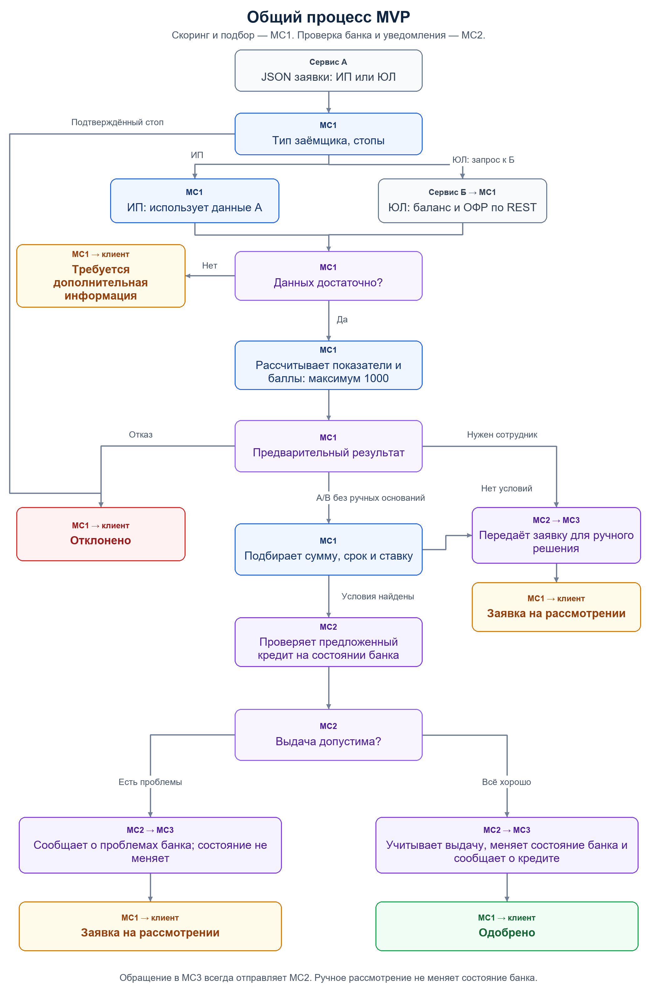
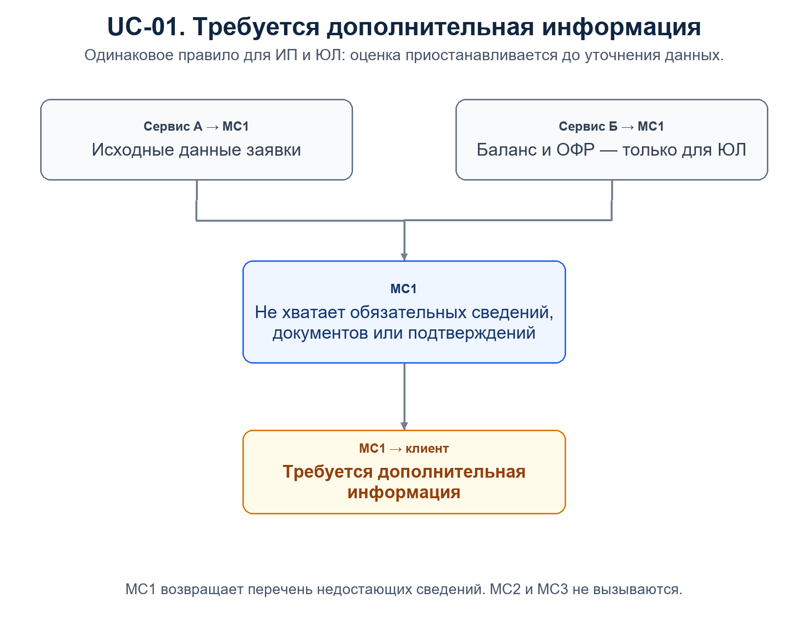
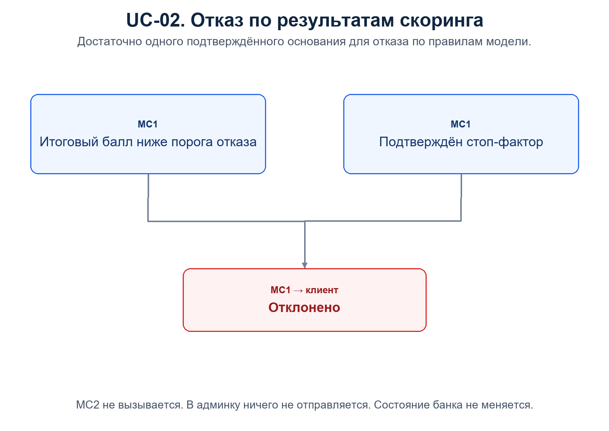
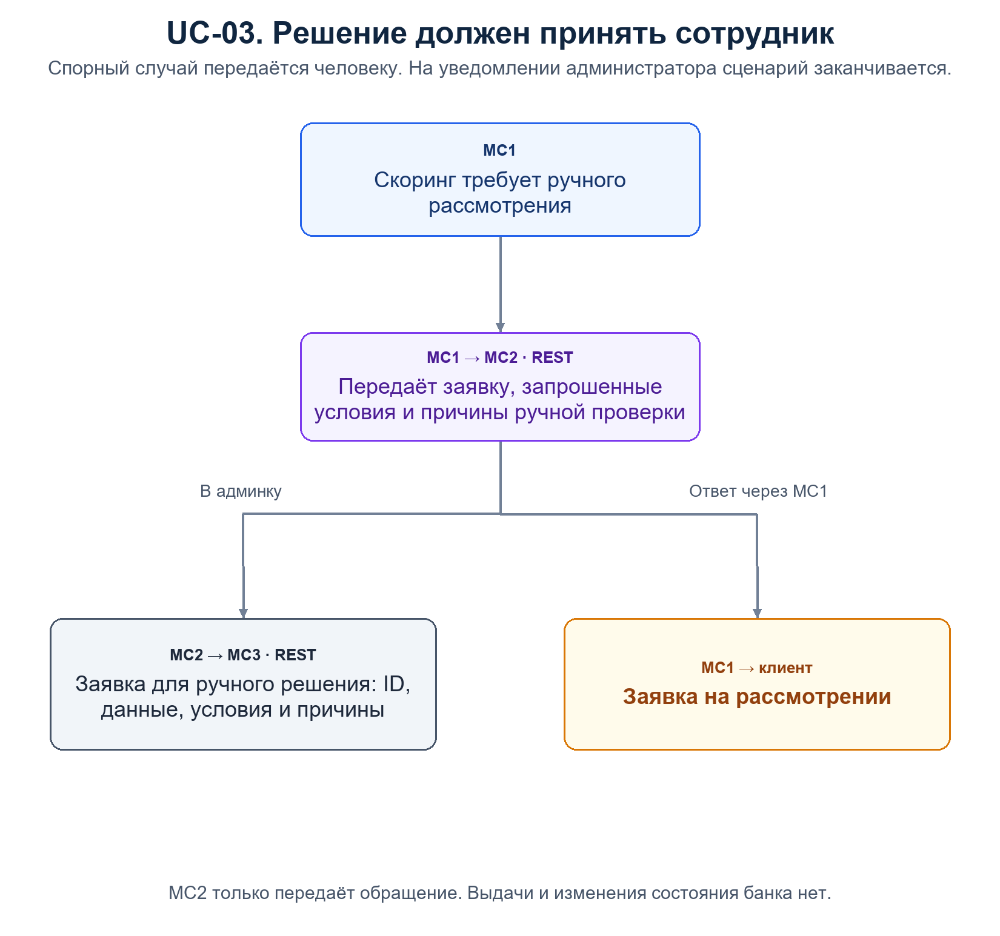
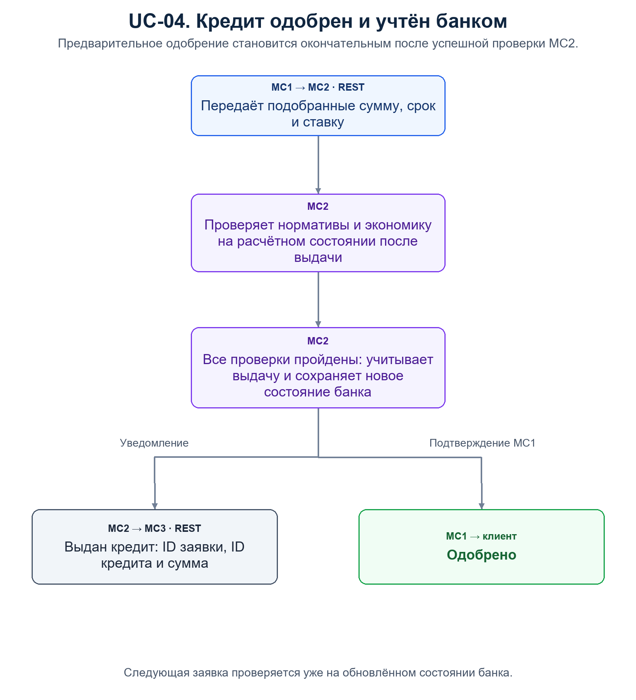
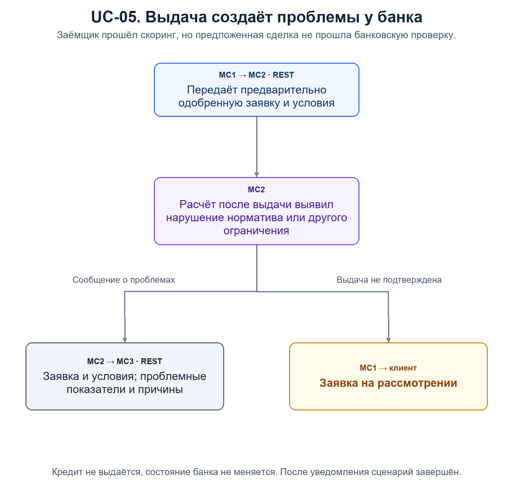
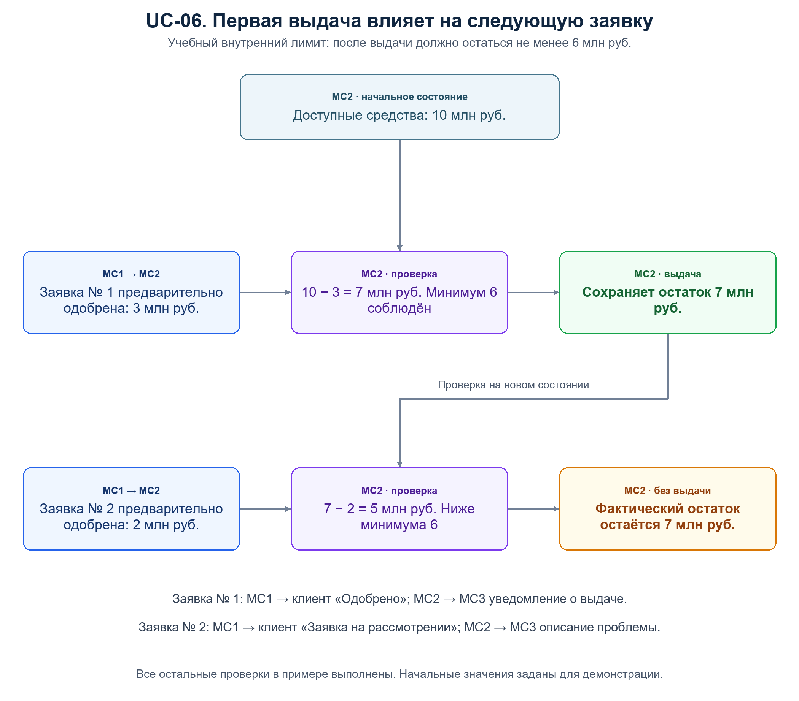

# MVP: общий процесс и юзер-стори

Согласованная логика на 23.10.2026. Заёмщики — ИП и юридические лица. Все межсервисные обращения — REST с JSON. Окончательные URL и поля определены в SPEC.md и contracts/. Автоматический подбор описан в 06_offer_selection.md.

## 1. Участники

| Участник | Ответственность |
|---|---|
| Сервис А | Передаёт в МС1 исходные данные заявки по модели ИП или ЮЛ. Баллы рассчитывает МС1. |
| Сервис Б | По запросу МС1 передаёт баланс и классический отчёт о финансовых результатах (ОФР, отчёт о прибылях и убытках) для ЮЛ. Для ИП не вызывается. |
| Микросервис1 (МС1) | Проверяет данные, рассчитывает экономические показатели и скоринг до 1000 баллов, формирует условия, выбирает маршрут и возвращает ответ клиенту. |
| Микросервис2 (МС2) | Хранит учебное состояние банка, проверяет предложенную сделку, учитывает выдачу и отправляет сообщения в админку. Также передаёт туда заявки для ручного решения. |
| Микросервис3 (МС3) | Админка: показывает выданные кредиты, заявки для ручного решения и заявки, создающие проблемы банку. |

Клиент получает окончательный статус от МС1. Напрямую в админку МС1 не обращается.

## 2. Основные правила

1. Для ИП и ЮЛ используются разные исходные наборы и скоринговые критерии. Дополнительные показатели рассчитываются внутри МС1; вместе с остальными критериями они дают не более 1000 баллов.
2. Подтверждённый стоп-фактор приводит к отказу. Недостаток сведений требует их запроса; пропуск не заменяется нулём.
3. Запрос данных и отказ завершаются в МС1. В МС2 передаются только предварительно одобренные заявки и заявки, требующие ручного решения.
4. При предварительном одобрении МС2 сначала рассчитывает влияние сделки. Сохранение нового состояния банка происходит только после успешной проверки и учебной выдачи кредита.
5. При ручном рассмотрении МС2 только передаёт обращение в админку. При проблемах банка он передаёт описание проблем. В обоих случаях выдачи и изменения состояния банка нет.
6. В MVP подтверждённое автоматическое одобрение считается учебной выдачей. Реальное перечисление денег, решение сотрудника и устранение банковских проблем не моделируются.

## 3. Общий процесс

МС1 получает данные от А. Для ЮЛ он дополнительно запрашивает у Б две формы отчётности. После проверки достаточности данных МС1 рассчитывает показатели и баллы, применяет правила ручного рассмотрения. Для стандартного маршрута он автоматически подбирает сумму, срок и ставку; при отсутствии допустимого предложения передаёт заявку сотруднику.

При известном стоп-факторе отказ возможен без завершения всех остальных расчётов. «Заявка на рассмотрении» означает либо необходимость ручного решения по заёмщику, либо проблему банка при проверке выдачи.

## 4. Результаты обработки

| Ситуация в МС1 | Обращение в МС2 | Ответ клиенту | Сообщение МС2 в админку | Изменение состояния банка |
|---|---|---|---|---|
| Не хватает данных | Нет | Требуется дополнительная информация | Нет | Нет |
| Отказ по скорингу или стоп-фактору | Нет | Отклонено | Нет | Нет |
| Нужен сотрудник | Передача на ручное рассмотрение | Заявка на рассмотрении | Заявка, запрос клиента и причины ручной проверки | Нет |
| Предварительно одобрено; проверка банка успешна | Проверка и учебная выдача | Одобрено | Выданный кредит: ID и сумма | Да |
| Предварительно одобрено; проверка банка выявила проблемы | Проверка без выдачи | Заявка на рассмотрении | Заявка, проблемные показатели и причины | Нет |

Вызов МС2 для ручного рассмотрения и вызов для проверки выдачи — разные маршруты. При ручном маршруте банковская проверка выдачи не запускается.

## 5. Отдельные юзер-стори

### UC-01. Не хватает данных

**Условие.** Для завершения оценки отсутствуют необходимые сведения или подтверждения. Например, не указан график существующих долгов либо для ЮЛ не получен ОФР.

**Ход.** МС1 выявляет недостающие сведения и возвращает их понятный перечень.

**Результат.** Клиент получает «Требуется дополнительная информация». МС2 и МС3 не вызываются; состояние банка не меняется. Текущая обработка завершена. После дополнения сведений оценку можно выполнить заново.

### UC-02. Заёмщику отказано

**Условие.** Итоговый балл ниже согласованного порога отказа либо подтверждён стоп-фактор.

**Ход.** МС1 применяет правила отказа и формирует объяснение.

**Результат.** Клиент получает «Отклонено». МС2 не вызывается, сообщения в админку нет, состояние банка не меняется.

### UC-03. Требуется решение сотрудника

**Условие.** Скоринг выявил спорный случай, который по правилам модели требует индивидуального рассмотрения. Например, сработало правило ручного маршрута для промежуточного класса заёмщика. Существенно недостающие исходные сведения сначала обрабатываются по UC-01.

**Ход.** МС1 направляет в МС2 заявку, запрошенные клиентом условия и причины ручного рассмотрения. Автоматически подобранного предложения здесь ещё нет. МС2 отправляет эти данные в МС3 для решения сотрудником.

**Результат.** МС1 возвращает клиенту «Заявка на рассмотрении». Кредит не выдаётся, состояние банка не меняется. На появлении обращения в админке сценарий заканчивается; последующее решение человека в MVP не реализуется.

### UC-04. Кредит одобрен

**Условие.** Заёмщик прошёл скоринг, условия определены, оснований для ручного рассмотрения нет.

**Ход.** МС1 передаёт предложение в МС2. МС2 проверяет нормативы, экономику и остальные ограничения на расчётном состоянии после выдачи. Все проверки пройдены: МС2 учитывает учебную выдачу, сохраняет изменённые величины банковского состояния и отправляет в МС3 сведения о кредите. МС1 получает подтверждение.

**Результат.** Клиент получает «Одобрено». В админке показан выданный кредит с ID и суммой. Следующие заявки проверяются на обновлённом состоянии банка.

### UC-05. Кредит создаёт проблемы банку

**Условие.** МС1 предварительно одобрил заёмщика и определил условия. МС2 установил, что выдача нарушит норматив, внутреннее ограничение или условие экономической допустимости.

**Ход.** МС2 не подтверждает выдачу и сообщает МС1 результат проверки. В МС3 он передаёт заявку, условия и перечень проблем: какой показатель не проходит, его расчётное значение и допустимую границу, когда они применимы.

**Результат.** МС1 возвращает «Заявка на рассмотрении». Кредит не выдаётся; расчётное состояние после выдачи не сохраняется. На уведомлении администратора сценарий заканчивается. Повторный подбор после банковской проблемы и устранение самой проблемы не моделируются. Первоначальный автоматический подбор выполняется МС1 до этой проверки.

### UC-06. Первая выдача влияет на следующую заявку

**Условие.** При старте МС2 получает произвольное учебное состояние. Для наглядности здесь показан один внутренний контроль: после выдачи должно оставаться не менее 6 млн руб. доступных средств. Начальный остаток — 10 млн руб.; остальные проверки в примере выполнены. Это иллюстрация динамики, а не формула банковского норматива.

| Шаг | Действие | Проверка | Сохранённый остаток | Результат |
|---|---|---|---|---|
| 0 | Учебная инициализация МС2 | Остаток 10 млн руб.; минимум 6 млн руб. | 10 млн руб. | Банк готов к проверке заявок |
| 1 | МС1 предварительно одобряет заявку № 1 на 3 млн руб. | 10 − 3 = 7; минимум соблюдён | 7 млн руб. | «Одобрено»; МС2 сообщает в админку о выдаче |
| 2 | МС1 предварительно одобряет заявку № 2 на 2 млн руб. | 7 − 2 = 5; минимум нарушен | 7 млн руб. | «Заявка на рассмотрении»; МС2 сообщает в админку о проблеме |

**Результат.** Вторая заявка проверяется с учётом первой выдачи. Неуспешная проверка не уменьшает фактический остаток. Если бы второй кредит проверялся на начальном остатке 10 млн руб., этот конкретный контроль был бы пройден.

## 6. Что должно быть видно на демонстрации

Каждый сценарий UC-01–UC-05 показывается для ИП и ЮЛ. Отличается получение и расчёт данных заёмщика; маршрутизация после скоринга одинакова. В UC-06 две заявки обрабатываются последовательно в одном запуске МС2.

Проверяющий видит четыре клиентских статуса, два разных основания для «Заявка на рассмотрении», сообщения в админке только от МС2 и изменение банковских величин только при выдаче. Внутреннее начальное состояние банка задаётся учебными значениями; реальная банковская инфраструктура для этих сценариев не требуется.

## 7. Отдельные рисунки

PNG-версии встроены выше. SVG подходят для увеличения и включения в презентацию.

| Рисунок | PNG | SVG |
|---|---|---|
| Общий процесс | [PNG](diagrams/00_overview.png) | [SVG](diagrams/00_overview.svg) |
| UC-01. Запрос данных | [PNG](diagrams/01_need_data.png) | [SVG](diagrams/01_need_data.svg) |
| UC-02. Отказ | [PNG](diagrams/02_decline.png) | [SVG](diagrams/02_decline.svg) |
| UC-03. Ручное решение | [PNG](diagrams/03_manual_review.png) | [SVG](diagrams/03_manual_review.svg) |
| UC-04. Одобрение | [PNG](diagrams/04_approved.png) | [SVG](diagrams/04_approved.svg) |
| UC-05. Проблемы банка | [PNG](diagrams/05_bank_review.png) | [SVG](diagrams/05_bank_review.svg) |
| UC-06. Две заявки | [PNG](diagrams/06_dynamic_state.png) | [SVG](diagrams/06_dynamic_state.svg) |
