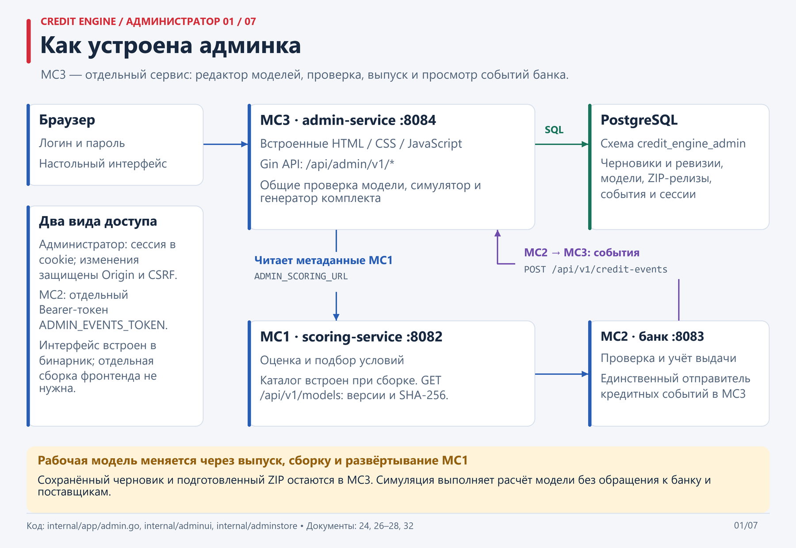
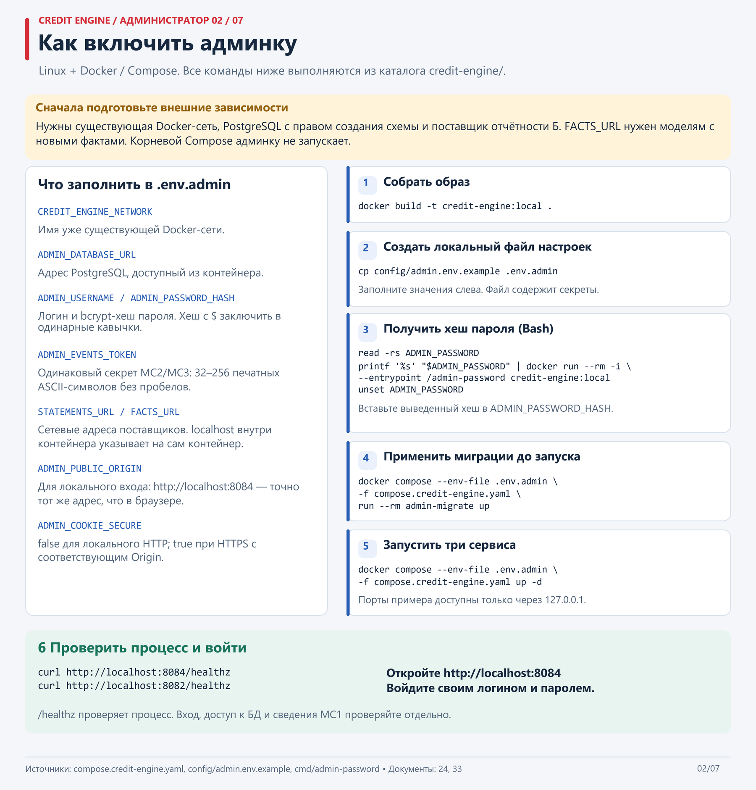
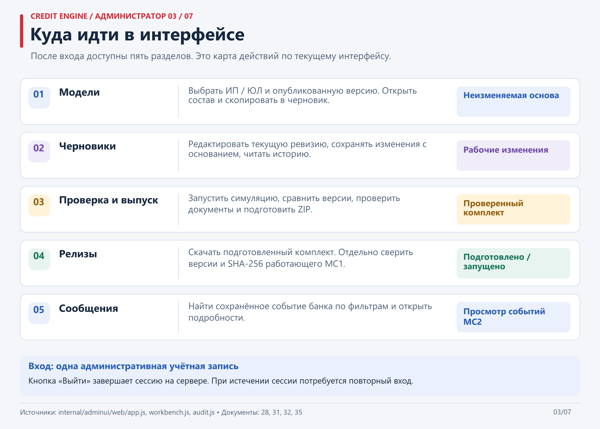
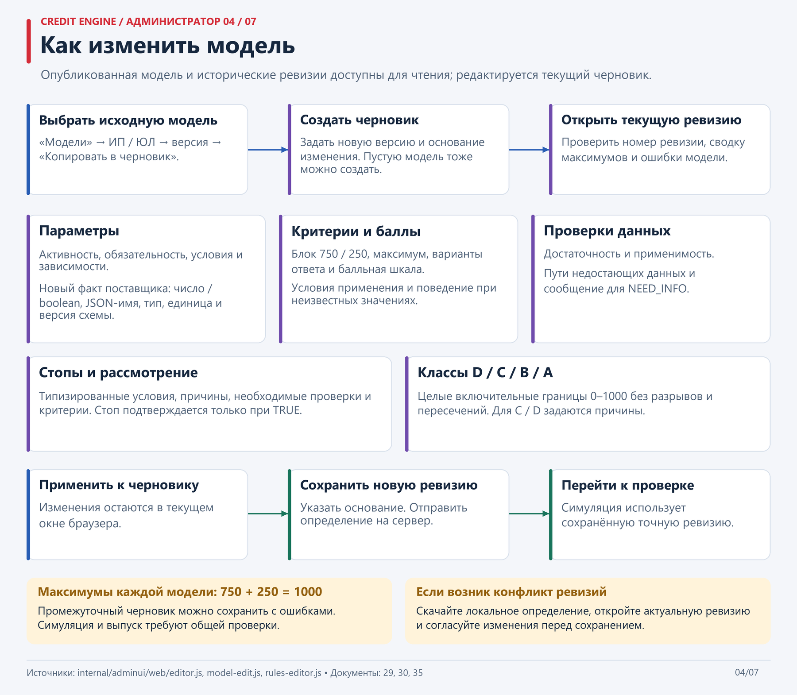
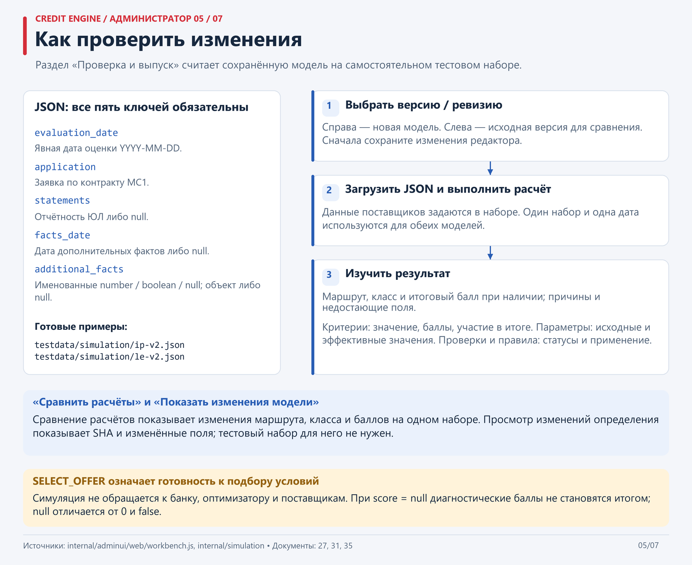
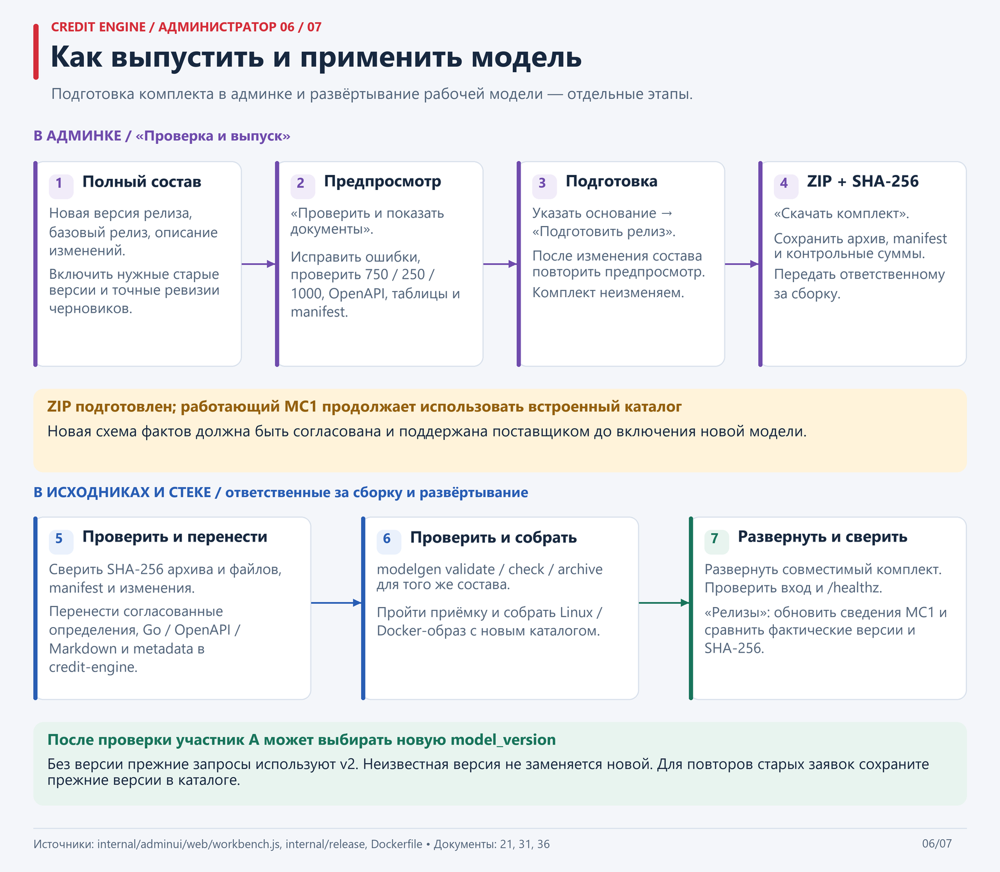
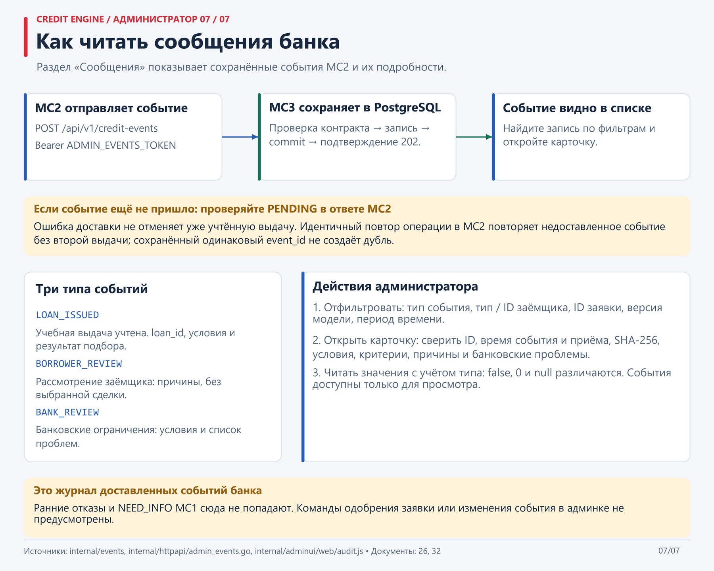

# Административный кабинет: схемы

Семь PNG объясняют устройство реализованной админки МС3, запуск в Linux через Docker и действия администратора. Названия разделов и кнопок сверены с текущим интерфейсом; команды — с `compose.credit-engine.yaml`, настройками и руководствами. Схемы интерфейса показывают порядок действий, а не скриншоты.

## Оглавление

| PNG | Что объясняет | Подробности |
|---|---|---|
| [07 — Устройство](07_admin_architecture.png) | Браузер, МС3, PostgreSQL, МС1/МС2, два вида доступа и направления взаимодействия | [Доступ](../24_admin_access.md), [интерфейс](../28_admin_interface.md) |
| [08 — Включение](08_admin_startup.png) | Внешние зависимости, `.env.admin`, bcrypt-хеш, миграции, запуск и вход | [Контейнерная поставка](../33_container_delivery.md), [пример настроек](../../config/admin.env.example), [Compose](../../compose.credit-engine.yaml) |
| [09 — Навигация](09_admin_navigation.png) | Назначение пяти разделов и результат работы в каждом | [Интерфейс](../28_admin_interface.md), [руководство администратора](../35_administrator_guide.md) |
| [10 — Редактирование модели](10_admin_model_editing.png) | Копирование в черновик, параметры, баллы, правила, классы, сохранение ревизии и конфликт изменений | [Параметры и баллы](../29_parameter_editor.md), [правила и классы](../30_rules_editor.md) |
| [11 — Симуляция](11_admin_simulation.png) | Пять ключей JSON-набора, выбор сохранённой ревизии, расчёт, диагностика и сравнение | [Формат набора](../27_simulation.md), [работа через интерфейс](../31_simulation_release_ui.md) |
| [12 — Выпуск и применение](12_admin_release.png) | Полный состав каталога, предпросмотр, ZIP/SHA-256, перенос, сборка, развёртывание и сверка МС1 | [Выпуск и интеграция](../36_release_and_integration.md), [modelgen](../21_modelgen_cli.md) |
| [13 — Сообщения банка](13_admin_messages.png) | Доставка и сохранение события, PENDING, три типа сообщений, фильтры и карточка | [Приём событий](../26_credit_events.md), [сообщения и работающие версии](../32_events_runtime_ui.md) |

## 07. Как устроена админка

МС3 хранит административные данные в PostgreSQL, принимает события только от МС2 и получает метаданные рабочего каталога от МС1. Изменения проходят отдельный путь выпуска и развёртывания.



## 08. Как включить админку

Команды на схеме выполняются из `credit-engine/` в Linux; получение пароля показано для Bash. После `read` введите пароль и нажмите Enter. Образ включает утилиту `admin-password`, поэтому локальный Go не требуется. `.env.admin` заполняется локальными настройками; хеш с `$` заключают в одинарные кавычки.

Сеть, PostgreSQL и поставщики готовятся отдельно: компонентный Compose их не создаёт. Корневой Compose не подключает МС1/МС2/МС3. Для изменённого порта или адреса согласуйте `ADMIN_PUBLIC_ORIGIN` с адресом браузера. `ADMIN_SCORING_URL` в компонентном Compose уже указывает на `http://scoring-service:8082`.



## 09. Куда идти в интерфейсе

Подготовленные релизы и сведения о реально запущенных версиях МС1 отображаются отдельно. При недоступности МС1 его версии не подменяются содержимым подготовленного комплекта.



## 10. Как изменить модель

«Применить к черновику» меняет данные в текущем окне. Для серверного сохранения нужны основание и кнопка «Сохранить новую ревизию». Промежуточный черновик можно хранить с ошибками; симуляция и выпуск требуют успешной проверки. Максимумы каждой модели — ровно 750 + 250 = 1000.



## 11. Как проверить изменения

Примеры самостоятельных наборов: [ИП v2](../../testdata/simulation/ip-v2.json) и [ЮЛ v2](../../testdata/simulation/le-v2.json). Симулятор использует явно выбранную модель или точную сохранённую ревизию. `application.model_version` внутри набора не выбирает движок симуляции. Все пять ключей набора обязательны; допустимые `null` сохраняют неизвестность. Набор и результат симуляции сервер не сохраняет.



## 12. Как выпустить и применить модель

Подготовка ZIP не меняет рабочую оценку МС1. После переноса согласованного комплекта нужны проверки, сборка и развёртывание, затем сверка фактических версий и SHA-256. Новая схема поставщика должна быть доступна до включения новой модели; старые версии сохраняются для повторов прежних заявок.



## 13. Как читать сообщения банка

Успешный ACK отправляется после commit PostgreSQL. При недоставке МС2 сохраняет PENDING; идентичный повтор операции повторяет доставку без второй выдачи. Сохранённое событие доступно только для чтения. Перезапуск МС2 сбрасывает его учебное состояние и PENDING — это ограничение сохранности описано в [поставке](../33_container_delivery.md).



## Исходник и обновление PNG

Тексты и вёрстка находятся в [render_admin_diagrams.py](../../scripts/render_admin_diagrams.py). Для повторной генерации нужны Python 3, Pillow и шрифты Segoe UI/Consolas в Windows либо DejaVu Sans/Mono в Linux:

```sh
python credit-engine/scripts/render_admin_diagrams.py
```

Команду выше выполняют из корня репозитория; путь вывода определяется расположением скрипта. Генератор создаёт только семь PNG `07_admin_*`–`13_admin_*` шириной 1800 пикселей в этом каталоге. Он проверяет размещение текста внутри карточек, а итоговые изображения требуют визуальной проверки после изменения содержания или шрифтов. Все строки доступны для редактирования без запуска приложения, БД или сети. Схемы `00`–`06` относятся к [исходным сценариям кредитования](../01_user_cases.md).
