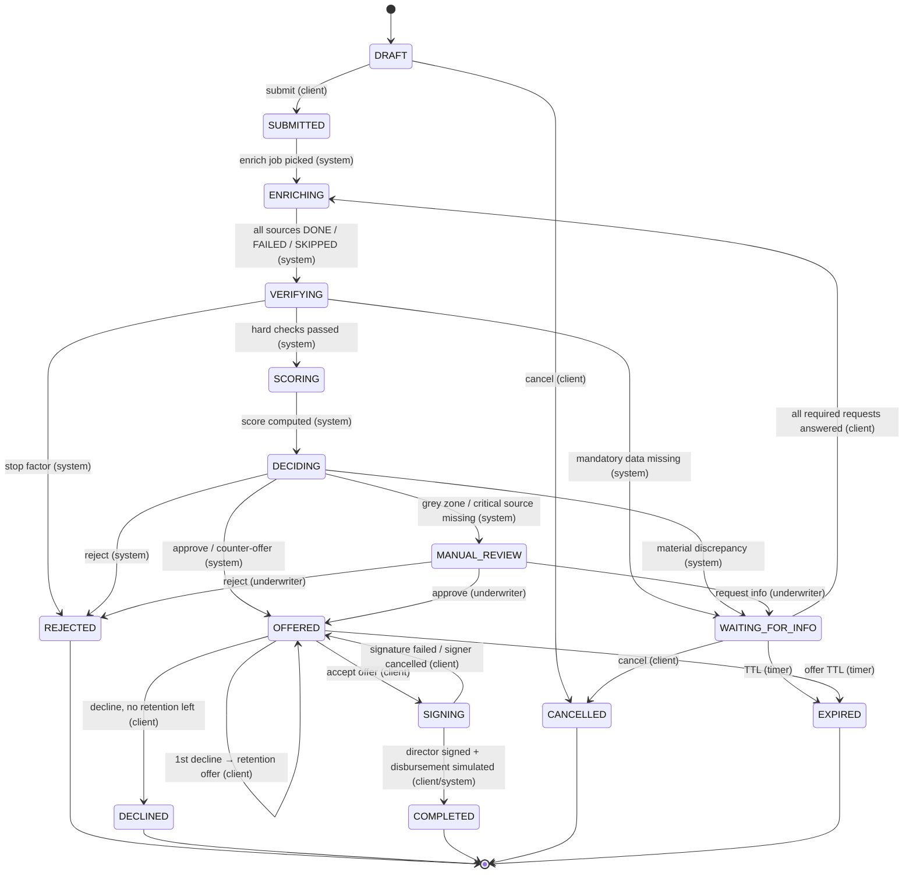

# FSM заявки

Источник правды по статусу — таблица `applications.status` + журнал `application_events`.
Каждый переход выполняется одной транзакцией:

```sql
UPDATE applications SET status = $to, version = version + 1, updated_at = now()
 WHERE id = $id AND status = $from AND version = $version;   -- 0 rows → 409/412
INSERT INTO application_events (...);                          -- timeline + аудит
-- enqueue следующей pgqueue-таски в той же транзакции (та же БД → атомарно, outbox не нужен)
```

После коммита публикуется событие в WebSocket-хаб (см. [websocket.md](websocket.md)).

## Диаграмма



## Таблица переходов

| From | Event | To | Actor | Guard / примечание |
|---|---|---|---|---|
| DRAFT | `submit` | SUBMITTED | client | черновик полный, согласия (ПДн, БКИ) даны, у пользователя есть доступ к компании |
| DRAFT | `cancel` | CANCELLED | client | |
| SUBMITTED | `enrich.started` | ENRICHING | system | воркер взял таску. Для фронта SUBMITTED ≈ «в очереди» |
| ENRICHING | `enrich.completed` | VERIFYING | system | у всех источников терминальное состояние. Свежие данные из кэша по ИНН берутся без похода наружу |
| VERIFYING | `verify.stop_factor` | REJECTED | system | ликвидация/банкротство, недостоверность, возраст компании меньше минимального |
| VERIFYING | `verify.missing` | WAITING_FOR_INFO | system | нет обязательного (например, доверенность, если заявку подал не директор) |
| VERIFYING | `verify.passed` | SCORING | system | |
| SCORING | `score.computed` | DECIDING | system | при расхождении «заявлено ↔ найдено» скоринг считается на **консервативном** значении |
| DECIDING | `decision.offer` | OFFERED | system | 1–3 оффера: запрошенный / альтернативные |
| DECIDING | `decision.reject` | REJECTED | system | |
| DECIDING | `decision.material_discrepancy` | WAITING_FOR_INFO | system | расхождение **меняет** результат (сумма/решение на заявленном значении лучше, чем на найденном). Клиенту задаётся нейтральный вопрос, источник не раскрывается |
| DECIDING | `decision.manual` | MANUAL_REVIEW | system | серая зона скоринга, или упал CRITICAL-источник, влияющий на запрошенную сумму |
| MANUAL_REVIEW | `uw.approve` / `uw.reject` / `uw.request_info` | OFFERED / REJECTED / WAITING_FOR_INFO | underwriter | |
| WAITING_FOR_INFO | `info.provided` | ENRICHING | client | все `required` info-requests отвечены. Переобогащаются только затронутые источники |
| WAITING_FOR_INFO | `ttl` | EXPIRED | timer | по умолчанию 7 дней (настраивается для демо) |
| OFFERED | `offer.accept` | SIGNING | client | оффер ACTIVE и не истёк |
| OFFERED | `offer.decline` | OFFERED | client | первый отказ, decision engine смог собрать retention-оффер |
| OFFERED | `offer.decline` | DECLINED | client | retention уже был или собрать его не удалось |
| OFFERED | `ttl` | EXPIRED | timer | |
| SIGNING | `sign.confirmed` | COMPLETED | client (директор) | подписать может **только директор** компании. Для КЭП — отчёт по политике `LOAN_CONTRACT` с вердиктом VALID / VALID_WITH_WARNINGS ([e-signature.md](e-signature.md)); выдача имитируется синхронно |
| SIGNING | `sign.failed` | OFFERED | client | подпись INVALID / подписант отменил. При INDETERMINATE (OCSP/CRL недоступны) заявка остаётся в SIGNING до повторной проверки |

`CANCELLED` из любого нетерминального состояния до `SIGNING` — опционально. По умолчанию разрешено только из DRAFT и WAITING_FOR_INFO, остальные статусы обрабатывает система.

## Что видит клиент

Клиент не видит, по каким источникам мы ходим. Статусы схлопываются в клиентские этапы (`client_stage` в `GET /applications/{id}/status`):

| client_stage | Статусы | Текст для UI |
|---|---|---|
| `FILLING` | DRAFT | Заполнение заявки |
| `REVIEW` | SUBMITTED, ENRICHING, VERIFYING, SCORING, DECIDING, MANUAL_REVIEW | Рассматриваем заявку |
| `ACTION_REQUIRED` | WAITING_FOR_INFO | Нужно уточнить пару моментов |
| `OFFER` | OFFERED | Решение готово |
| `SIGNING` | SIGNING | Подписание договора |
| `DONE` | COMPLETED | Кредит выдан |
| `CLOSED` | REJECTED, DECLINED, CANCELLED, EXPIRED | Заявка закрыта |

## Критичность источников (для перехода в MANUAL_REVIEW)

| Источник | Критичность | Если упал |
|---|---|---|
| EGRUL / EGRIP | CRITICAL | без него нельзя подтвердить существование компании → MANUAL_REVIEW |
| BKI | CRITICAL | → MANUAL_REVIEW, если запрошенная сумма больше порога «без БКИ» |
| GIRBO (бухотчётность) | CRITICAL для сумм > порога | лимит считается только по заявленной выручке с дисконтом; если запрошено больше → MANUAL_REVIEW |
| PB_NALOG, FSSP, FEDRESURS, KAD, RNP | NORMAL | фактор пропускается, в dossier помечается `degraded` |
| EGRN | NORMAL, только при залоге недвижимости | залог не учитывается в лимите |
| BANK_INTERNAL | NORMAL | |
