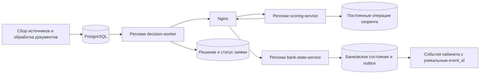

# Отправка заявок в скоринг

`data-collector-decision-worker` — отдельный процесс. PostgreSQL хранит очередь и
снимки; Kafka продолжает обслуживать сбор источников, подписи и финансовые документы.



## Готовность и снимок

Воркер проверяет завершение последней задачи сбора по заявке, отсутствие подписей
в `PENDING` и завершение текущих поколений финансовых документов. `COMPLETED` и
`FAILED` завершают этап; отдельные источники могут иметь `PARTIAL` или `SKIPPED`.
Истечение времени ожидания подписи не разрешает отправку незавершённой заявки.
Отправляются доступные данные; нехватку определяет скоринг через `NEED_INFO`.

Задание и снимок создаются одной транзакцией с блокировкой заявки. Снимок включает
точный запрос, исходные данные анкеты и сбора, идентификатор сбора, актуальные
поколения документов, отчёты проверки, допущенные показатели, диагностику и дату.
Используются модели `ip-v2` и `legal-v2`. Их формулы не изменены.

Для отчётности ООО сохраняются отсутствующие строки и явные нули; суммы ФНС
переводятся из тысяч рублей в рубли без округления. КУДиР передаётся отдельным
налоговым показателем, без превращения в бухгалтерскую выручку или денежный поток.
Сопоставимые показатели одного периода сверяются. Расхождения сохраняются и дают
`NEED_INFO`; подтверждённые стоп-факторы сохраняют приоритет. Источники прошлых
раундов и результаты прошлых поколений не подменяют актуальные.

## Повторы и сохранность

Статусы `scoring_jobs`: `PENDING → RUNNING → COMPLETED`;
при временной ошибке — `RETRY_WAIT`, при окончательной — `FAILED`.
У заявки не больше одного активного задания. Реплики захватывают разные задания
через `FOR UPDATE SKIP LOCKED`. Продление и завершение проверяют токен владельца
и срок захвата. HTTP выполняется вне транзакций.

Каждый раунд использует `Idempotency-Key = scoring_jobs.id`. `input_snapshot`
передаёт неизменяемые дату, отчётность, показатели и диагностику. Снимок требует
этот заголовок. Старый запрос без снимка сохраняет прежний контракт.
Одинаковый ключ и вход возвращают сохранённый ответ; изменённый вход даёт
`409 IDEMPOTENCY_CONFLICT`; занятый раунд — `409 OPERATION_IN_PROGRESS` и `Retry-After`.

Скоринг сохраняет подготовленное решение и точный банковский запрос до вызова банка.
После сбоя он продолжает этот шаг. Банк атомарно сохраняет изменение лимитов,
операцию, выдачу и событие. У выдачи уникальный `application_id`, у операции —
идентификатор раунда. Outbox доставляется после коммита; кабинет подавляет дубли
через `credit_event_inbox`. Подтверждение события не удерживает банковскую блокировку.

Сетевые ошибки, `429`, `5xx` и занятый раунд повторяются. Прочие ошибки контракта
останавливают задание и передают заявку на ручное рассмотрение с технической причиной.
Ответ скоринга сохраняется до применения результата в кабинете: при сбое записи
следующая попытка завершает локальную транзакцию. Решение, предложение, вопросы,
статус и событие завершения фиксируются атомарно, один раз на задание.

## Запуск и переход

При обновлении остановите отправляющий воркер и сервисы credit-engine, примените
миграции общей БД, затем запустите обновлённые процессы. При первом запуске банк
инициализируется исходным учебным снимком, как согласовано для этого изменения.
Старые операции из памяти не переносятся. Заявки, решения и история кабинета
сохраняются, завершённые заявки автоматически не отправляются повторно.
При последующих перезапусках банк читает состояние из PostgreSQL.

```sh
docker compose stop data-collector-decision-worker credit-engine-scoring credit-engine-bank
docker compose build migrate data-collector-decision-worker credit-engine-scoring
docker compose run --rm migrate up
docker compose up -d --build
docker compose up -d --scale data-collector-decision-worker=3 \
  --scale credit-engine-scoring=2 --scale credit-engine-bank=2
```

Образы всех реплик должны содержать одинаковые версии моделей и политики.
Порт хоста принадлежит Nginx; банковские ручки доступны через внутренний listener,
публичный listener сохраняет только API скоринга. Новые Go-сервисы требуют
`DATABASE_URL` и не создают схему автоматически. В подключаемом Compose
credit-engine задайте `CREDIT_RUNTIME_DATABASE_URL` и сначала выполните
`docker compose -f compose.credit-engine.yaml run --rm runtime-migrate up`.

| Настройка воркера | По умолчанию |
|---|---|
| `DECISION_CONCURRENCY` | `4` |
| `DECISION_POLL_INTERVAL` | `2s` |
| `SCORING_TIMEOUT` | `20s` |
| `DECISION_LEASE` | `60s` |
| `DECISION_HEARTBEAT` | `10s` |
| `DECISION_MAX_ATTEMPTS` | `8` |
| `DECISION_HTTP_ADDR` | `:9090` |

Повтор откладывается на 2–120 секунд с небольшим случайным разбросом;
`Retry-After` учитывается. Внутренние `/healthz`, `/readyz`, `/metrics` воркера
показывают доступность процесса/БД, размер и возраст очереди, ошибки, повторы и
суммарное время обработки. В логах есть заявка, задание, раунд и попытка.
Окончательные технические ошибки доступны в `scoring_jobs.last_error` и журнале.
Восстановление технически упавшего раунда должно сохранять прежний идентификатор
задания и ключ, поскольку банк уже мог учесть операцию.

## Проверки

```sh
python3 scripts/verify-scoring.py
```

Скрипт создаёт отдельный Compose-проект с вымышленными данными, 3 воркерами,
2 экземплярами скоринга и 2 экземплярами банка. Он обрабатывает 100 раундов,
проверяет конфликты ключей, восстановление подготовленного запроса после выдачи,
перезапуск процессов, доставку outbox после недоступности кабинета и балансировку.
После проверки удаляется только этот тестовый проект. Логи и итоговый JSON остаются
в `.work/scoring/`. `--keep` сохраняет стенд для диагностики.

Новые Go integration-тесты используют `SCORING_TEST_DATABASE_URL`: создают отдельную
временную базу на каждый тест, применяют миграции и удаляют базу после завершения.
Они проверяют готовность поколений, захват, потерю владения, новый раунд, конкурентный
inbox, потерю ответа после банковского коммита и несколько реплик. Тестовый пользователь
PostgreSQL должен иметь право создавать базы. Пример DSN — только для вымышленного стенда.
